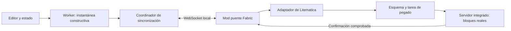

# Spec: preview en vivo mediante Litematica

Fecha: 2026-10-16  
Estado: propuesta para revisión; implementación no iniciada.  
Dependencia arquitectónica: Litematica obligatoria.

## 1. Objetivo

Permitir que una persona edite un map art en MapArtisan y vea su construcción
actualizada automáticamente mediante bloques reales en un mundo de pruebas de
Minecraft. Litematica será responsable de representar y pegar el esquema; un
mod puente conectará el navegador con Litematica.

La estructura recibida en Minecraft debe coincidir con la estructura constructiva
que MapArtisan usa para exportar, incluidos alturas, soportes y línea norte
(noobline). Un esquema holográfico por sí solo no cumple el objetivo.

Este documento no autoriza cambios de aplicación ni la creación del mod. Define
el alcance y las comprobaciones previas a implementar.

## 2. Alcance inicial

- Minecraft Java 26.3, Fabric, mundo singleplayer creativo en el mismo equipo.
- Litematica y su MaLiLib compatible instalados como dependencias obligatorias.
- MapArtisan servido localmente; conexión WebSocket mediante loopback.
- Una sesión, una pestaña con control de escritura y una construcción activa.
- Un mapa de 128 × 128 píxeles, modos 2D y 3D valley.
- Pintura manual, deshacer/rehacer y cambios en imagen, paleta, procesamiento,
  alturas y soportes deben producir una nueva revisión de la construcción.
- Una zona vacía y reservada dentro de un mundo descartable.
- Flujo unidireccional MapArtisan → Minecraft.

Quedan fuera de v1: multiplayer/LAN, Servux, otros loaders o versiones de
Minecraft, sincronización de ediciones hechas dentro del juego, entidades,
inventarios/NBT de entidades de bloque, multimap y secciones independientes,
rotaciones arbitrarias, web pública HTTPS y soporte sin Litematica.

La exportación manual a Litematica/NBT y el preview web deben seguir funcionando
sin conexión al mod. El puente no es necesario para utilizar esas funciones.

## 3. Base existente y punto de integración

Se reutilizará la ruta activa de exportación:

- `src/hooks/useProcessingPipeline.ts`: procesamiento y rechazo de resultados
  obsoletos.
- `src/workers/mapart.worker.ts`: motor, caché y aplicación de ediciones.
- `src/utils/export/blockGeneration.ts`: construcción con coordenadas enteras.
- `src/utils/export/types.ts`: buffers de posiciones e índices de paleta.
- `src/hooks/latestWinsQueue.ts`: patrón de conservar el último trabajo pendiente.

No se usará el módulo legado `src/utils/schematicExport.ts`, que no participa en
la exportación de la interfaz. Tampoco se reconstruirán bloques a partir de las
posiciones visuales centradas del preview Three.js.

Se expondrá una operación del worker que produzca una instantánea constructiva
antes de serializar NBT. Incluirá las ediciones manuales exactamente una vez.
Los buffers transferidos no podrán reutilizarse después de quedar detached.

El disparador debe observar todos los parámetros constructivos, no solo cambios
en la imagen procesada: cambiar el material de soporte también debe sincronizar.

## 4. Arquitectura

### MapArtisan

Genera instantáneas completas y coherentes, asigna revisiones, conserva solo la
última pendiente y presenta el estado de conexión/aplicación. No ejecuta comandos
de Minecraft ni escribe archivos del mundo.

### Mod puente

Será un proyecto Fabric separado de BlockMaps. Gestionará conexión, sesión,
validación, permisos del mundo, área reservada y seguimiento de tareas. El hilo
de red únicamente recibe/valida mensajes; las operaciones del juego se despachan
al hilo apropiado de cliente o servidor.

### Adaptador de Litematica

Crea o actualiza un esquema y una colocación exclusivos de MapArtisan, conserva
su origen y solicita el pegado mediante Litematica. Mantendrá las llamadas a sus
clases concretas fuera del protocolo y del resto del puente.

Litematica es obligatoria: si falta o su versión no es compatible, la función
se deshabilita con un diagnóstico. No habrá un motor alternativo de colocación.
El adaptador tampoco modificará otras colocaciones del usuario.

## 5. Comprobación técnica previa obligatoria

Antes de construir la integración completa debe verificarse, con una combinación
fijada de Minecraft/Litematica/MaLiLib:

1. Crear y actualizar un esquema en memoria y registrar su colocación.
2. Mostrar el esquema actualizado sin reiniciar el juego.
3. Iniciar un pegado real en singleplayer creativo.
4. Detectar terminación y fallo de la tarea, no solo que fue programada.
5. Reemplazar bloques y colocar aire para retirar bloques anteriores.
6. Determinar el comportamiento efectivo de `changedBlocksOnly`.
7. Garantizar un único pegado activo y detectar descarga/cambio de mundo.
8. Aplicar el comportamiento necesario sin dejar alteradas preferencias globales
   de Litematica, selección, filtros de capas o tareas ajenas.

El código 26.3 consultado contiene `addSchematicPlacement(...)` y
`pastePlacementToWorld(..., changedBlocksOnly, ...)`. Se consideran puntos de
integración candidatos, no una API pública estable garantizada.

La versión exacta soportada de Litematica y MaLiLib se fijará al completar esta
comprobación. No se declarará compatibilidad con todas las versiones. Si no es
posible observar la finalización o controlar el pegado requerido, se revisará el
spec antes de desarrollar el resto; no se emitirá un éxito anticipado.

## 6. Modelo de estructura y coordenadas

Una instantánea contiene:

- Dimensiones de imagen y límites constructivos derivados de los bloques.
- Paleta de estados canónicos: ID namespaced y propiedades ordenadas.
- Posiciones locales enteras `x`, `y`, `z`, e índice de paleta por posición.
- Configuración constructiva y versión de Minecraft objetivo.
- Identificador y revisión de la sesión.

No se transmiten texturas ni colores RGB para colocar bloques. El mod resuelve
IDs y propiedades mediante el registro de Minecraft. Un ID o propiedad inválidos
rechazan toda la revisión antes de aplicar cambios; no se sustituyen por aire.
Posiciones duplicadas o fuera de límites también se rechazan.

Para v1, el origen elegido en Minecraft corresponde a `(0,0,0)` de la estructura
exportada: la línea norte ocupa `z=0` y la primera fila de píxeles `z=1`.
Se conserva la orientación de exportación, con el norte hacia Z negativa.
La alineación con mapas de escala 0 debe verificarse incluyendo esa fila extra;
la posición del jugador no se usa como origen móvil.

El origen y la dimensión quedan bloqueados durante la sesión. Cambiarlos requiere
detenerla y configurar otra área. Se validarán alturas reales del mundo.

## 7. Sustitución y limpieza

V1 transmitirá instantáneas completas. La optimización interna de pegado podrá
usar cambios únicamente si las pruebas demuestran que conserva el resultado.

El adaptador conservará los límites anteriores y nuevos. Dentro de la unión de
ambos volúmenes, las posiciones ausentes en la nueva estructura deben convertirse
en aire. Esto incluye bloques desplazados, soportes retirados y reducción de
altura. No basta pegar únicamente bloques no vacíos.

El área reservada debe estar vacía al iniciar y pertenecer exclusivamente a esta
sesión. El pegado, incluido el aire, queda limitado a ella. No se promete conservar
construcciones introducidas manualmente dentro de esa zona durante la sesión.

Un cambio de píxel 3D puede desplazar toda una columna. Se regenera la instantánea
constructiva para reflejar Smart Drop, normalización vertical y soportes. No se
asume que una pincelada corresponde a una única posición del mundo.

## 8. Protocolo local v1

WebSocket con protocolo versionado. El servidor escucha exclusivamente en
loopback, en un puerto configurable; nunca en todas las interfaces por defecto.

Mensajes lógicos:

| Mensaje | Dirección | Finalidad |
|---|---|---|
| `hello` / `welcome` | Ambas | Autenticar token, negociar protocolo y capacidades/versiones. |
| `openSession` / `sessionReady` | Ambas | Seleccionar mundo, dimensión, origen y área; conceder escritura. |
| `snapshotBegin` | Web → mod | Declarar revisión, base aplicada, límites, paleta y tamaños. |
| `snapshotChunk` | Web → mod | Transportar bloques por partes numeradas. |
| `snapshotEnd` | Web → mod | Cerrar transferencia e iniciar validación completa. |
| `accepted` | Mod → web | Transferencia validada; aún no significa aplicada. |
| `progress` | Mod → web | Informar la fase y avance comprobable. |
| `applied` | Mod → web | Confirmar que terminó la colocación de esa revisión. |
| `rejected` / `failed` | Mod → web | Informar código, revisión y posible aplicación parcial. |
| `status` / `ping` / `pong` | Ambas | Recuperar estado y detectar desconexiones. |
| `closeSession` | Web → mod | Detener la sesión y liberar el control de escritura. |

El sobre incluye `protocolVersion`, `sessionId` y `type`; los mensajes de
estructura añaden `revision`. `snapshotBegin` incluye `baseRevision`, que debe
coincidir con la última revisión aplicada reconocida por el mod.

Formato inicial: JSON, paleta compartida y listas compactas de enteros para
posiciones/índices. Cada transferencia declara número de partes y bloques;
partes faltantes, duplicadas o tamaños inconsistentes impiden aplicarla. No se
comienza a pegar mientras faltan partes. Se medirán costos antes de decidir
si una versión posterior necesita un formato binario.

Un resultado repetido de una revisión ya aplicada devuelve su confirmación sin
programar otro pegado. El mismo número con otro contenido se rechaza. La sesión
no se restaura silenciosamente tras reiniciar el mod.

## 9. Concurrencia y recuperación

- Una revisión en transferencia/aplicación y una instantánea pendiente reemplazable.
- Agrupación inicial de cambios de aproximadamente 200 ms; no es una garantía de latencia.
- Una edición nueva reemplaza la pendiente; no cancela a mitad el pegado activo.
- La base de la siguiente revisión se establece después de recibir `applied`.
- Resultados del worker que ya no corresponden al editor se descartan antes de enviar.
- Un timeout o corte de conexión nunca se interpreta como éxito ni provoca repetir
  automáticamente una tarea cuyo estado se desconoce.
- Tras reconectar se consulta la sesión. Si sigue activa y no tiene trabajo en
  curso, se solicita una instantánea completa con la base confirmada.
- Si hubo pegado parcial, se entra en `needsResync`. Se conserva la unión del área
  que pudo tocarse y se exige una resincronización completa controlada.
- Cambiar o cerrar el mundo invalida el destino y la sesión.
- No hay rollback instantáneo prometido. La recuperación es una resincronización
  completa; cerrar la sesión deja los bloques existentes en el mundo.

Estados visibles: desconectado, conectando, conectado sin destino, sincronizando,
sincronizado, pausado y error/requiere resincronización. La interfaz distinguirá
revisión del editor de revisión aplicada. Minecraft pausado debe figurar como
esperando al juego, sin acumular tareas ni confirmar una aplicación inexistente.

## 10. Controles y límites

MapArtisan ofrece conectar, desconectar, activar sincronización automática,
pausar envíos y resincronizar. Muestra mundo/dimensión, origen y revisión aplicada.
Pausar detiene nuevos envíos; una tarea activa termina si el juego sigue avanzando.
Desconectar no borra la construcción. La limpieza explícita de toda el área queda
fuera del primer prototipo.

El token se genera en el mod y se introduce en MapArtisan; no se guarda en el
repositorio ni se imprime completo en los logs. El puente valida el encabezado
Origin contra los orígenes locales configurados y limita una pestaña escritora.
El protocolo acepta estructuras, nunca comandos arbitrarios ni rutas de archivos.

Límites iniciales propuestos, sujetos a medición:

- Imagen: 128 × 128; altura constructiva máxima: 256 bloques, si cabe en el mundo.
- Hasta 65.536 posiciones explícitas y 8 millones de posiciones en el volumen de pegado.
- Mensajes de hasta 256 KiB; transferencia acumulada de hasta 16 MiB.
- Recepción incompleta: timeout de 10 segundos sin progreso.
- Aplicación: aviso tras 30 segundos sin progreso, consulta de estado y diagnóstico;
  no se programa otro pegado por ese motivo.

Superar límites se comunica antes de pegar. Se validan números enteros finitos,
límites de arrays y paleta, IDs y dimensiones para evitar asignaciones descontroladas.
No se mantiene cargado un número ilimitado de chunks. La estrategia de carga y
liberación de tickets se verificará junto con el comportamiento de Litematica.

## 11. Criterios de aceptación

1. Un diseño 128 × 128 se coloca con IDs, propiedades, alturas, soportes y noobline
   equivalentes a los buffers constructivos de exportación.
2. Cambiar material, altura o soporte reemplaza lo necesario y retira lo obsoleto.
3. Deshacer/rehacer converge al mismo resultado que una exportación del editor.
4. Una ráfaga de cambios termina en la última revisión, sin pegar versiones antiguas después.
5. `applied` solo llega al terminar; el estado de éxito se comprueba contra el área
   del mundo en las pruebas de integración, no solo contra llamadas del adaptador.
6. Desconexión, pausa del juego, fallo parcial y cambio de mundo no producen falsos éxitos.
7. No se toca ningún bloque fuera del área ni se alteran colocaciones/configuraciones ajenas.
8. Estados desconocidos y mensajes inválidos se rechazan antes de modificar el mundo.
9. El preview web y las exportaciones existentes funcionan con la función desconectada.

Pruebas: contratos y revisiones del protocolo; ensamblado de transferencias;
comparación de instantáneas con fixtures existentes de exportación; secuencias de
edición; integración real Fabric/Litematica para sustitución, aire y finalización;
comparación del registro de bloques del área con la instantánea esperada.

Se medirán tiempos de generación, transferencia, espera y pegado por separado.
El presupuesto de latencia se fijará tras el prototipo; no se promete un pegado
completo por frame ni cambios instantáneos bajo cualquier carga.

## 12. Etapas de implementación propuestas

1. Comprobación técnica de Litematica, fijación de dependencias y finalización observable.
2. Contrato de instantánea del worker y equivalencia con la exportación.
3. Puente local y pegado completo manual de una revisión.
4. Reemplazo con aire, confirmaciones, recuperación y aislamiento del destino.
5. Sincronización automática, controles y pruebas de ráfagas/undo/redo.
6. Medición y ajustes; solo después evaluar multimap, Servux o web publicada.

Prerrequisito de producto: Minecraft 26.3 ya está habilitado en las versiones
soportadas de MapArtisan (versión por defecto, DataVersion 5023), y los formatos
exportados se validaron en el juego el 2026-10-17.

## 13. Referencias consultadas

- Código del gestor de colocaciones de Litematica, rama 26.3:
  https://raw.githubusercontent.com/sakura-ryoko/litematica/26.3/src/main/java/fi/dy/masa/litematica/schematic/placement/SchematicPlacementManager.java
- Publicaciones de Litematica:
  https://github.com/sakura-ryoko/litematica/releases
- Documentación de pegado, con diferencias entre singleplayer y servidores:
  https://github.com/maruohon/litematica/wiki/Schematic-Pasting
- Servux 26.3, como posible ampliación posterior:
  https://github.com/sakura-ryoko/servux/blob/26.3/FEATURES.md
- Arquitectura cliente/servidor de Fabric:
  https://docs.fabricmc.net/develop/networking
- Conexiones WebSocket y restricciones del navegador:
  https://developer.mozilla.org/en-US/docs/Web/API/WebSockets_API/Writing_WebSocket_client_applications
