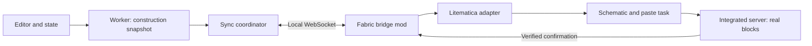

# Spec: live preview through Litematica

Date: 2026-10-16 (updated 2026-10-17 with the Litematica code review and stages 1–3)  
Status: stages 1–4 done (sections 5.4, 12.1, 12.2 and 12.3); stage 5
implemented (section 12.4); stage 6 pending.  
Architectural dependency: Litematica is required.  
Decision: keep Litematica as the paste engine through a task of our own
(section 5.2), confirmed by stage 1 on 2026-10-17 (section 5.4).

## 1. Goal

Let a person edit a map art in MapArtisan and see its construction updated
automatically with real blocks in a Minecraft test world. Litematica is
responsible for representing and pasting the schematic; a bridge mod connects
the browser to Litematica.

The structure received in Minecraft must match the construction structure
MapArtisan uses for export, including heights, supports and the north line
(noobline). A holographic schematic on its own does not meet the goal.

This document does not authorize application changes or creating the mod by
itself. It defines the scope and the checks required before implementing.

## 2. Initial scope

- Minecraft Java 26.3, Fabric, creative singleplayer world on the same machine.
- Litematica and its compatible MaLiLib installed as required dependencies.
- MapArtisan served locally or from its published site
  (`https://mapartisan.dfarium.com`, added 2026-10-17); WebSocket connection
  over loopback either way.
- One session, one tab with write control and one active construction.
- One 128 × 128 section at a time, in 2D and 3D valley modes, according to the
  *File Layout* (section 10.2): a 1 × 1 map with *Single File*, or the chosen
  section of a map of any size with *Multiple Files*.
- Manual painting, undo/redo and changes to image, palette, processing, heights
  and supports must produce a new construction revision.
- An empty, reserved zone inside a disposable world.
- One-way flow MapArtisan → Minecraft.
- Hidden by default: it can only be enabled from the browser console
  (section 10.1).

Out of v1: multiplayer/LAN, Servux, other loaders or Minecraft versions,
syncing edits made in the game, entities, inventories/block entity NBT, several
sections at once, maps larger than 128 in full export mode, arbitrary
rotations, Vercel preview deployments and support without Litematica.

Manual Litematica/NBT export and the web preview must keep working without a
connection to the mod. Those features do not need the bridge.

## 3. Existing base and integration point

The active export path is reused:

- `src/hooks/useProcessingPipeline.ts`: processing and rejection of stale
  results.
- `src/workers/mapart.worker.ts`: engine, cache and application of edits.
- `src/utils/export/blockGeneration.ts`: construction with integer coordinates.
- `src/utils/export/types.ts`: position buffers and palette indices.
- `src/hooks/latestWinsQueue.ts`: the keep-the-latest-pending-job pattern.

The legacy module `src/utils/schematicExport.ts`, which the UI export does not
use, is not used. Blocks are not rebuilt from the centered visual positions of
the Three.js preview either.

A worker operation produces a construction snapshot before NBT serialization.
It includes manual edits exactly once. Transferred buffers cannot be reused
once detached.

The trigger must observe every construction parameter, not only changes to the
processed image: changing the support material must sync too.

## 4. Architecture



### MapArtisan

Produces complete, consistent snapshots, assigns revisions, keeps only the
latest pending one and shows the connection/application state. It does not run
Minecraft commands or write world files.

### Bridge mod

A Fabric project separate from BlockMaps. It handles connection, session,
validation, world permissions, the reserved area and task tracking. The network
thread only receives/validates messages; game operations are dispatched to the
appropriate client or server thread.

### Litematica adapter

Creates a MapArtisan-only schematic and placement per revision, keeps its
origin and runs the paste with a task of its own on Litematica's infrastructure
(section 5.2). It keeps calls to Litematica's concrete classes out of the
protocol and the rest of the bridge.

Litematica is required: if it is missing or its version is not compatible, the
feature is disabled with a diagnostic. There is no alternative placement
engine. The adapter does not modify the user's other placements either.

## 5. Required technical check

Before building the full integration, the following must be verified with a
pinned Minecraft/Litematica/MaLiLib combination:

1. Create and update an in-memory schematic and register its placement.
2. Show the updated schematic without restarting the game.
3. Start a real paste in creative singleplayer.
4. Detect completion and failure of the task, not only that it was scheduled.
5. Replace blocks and place air to remove earlier blocks.
6. Determine the effective behavior of `changedBlocksOnly`.
7. Guarantee a single active paste and detect world unload/change.
8. Apply the required behavior without leaving Litematica's global preferences,
   selection, layer filters or other tasks altered.

The exact supported Litematica and MaLiLib versions are pinned when this check
is complete. Compatibility with every version is not claimed. If finishing
cannot be observed or the required paste cannot be controlled, the spec is
revised before building the rest; no early success is reported.

### 5.1 Source code review (2026-10-17)

Litematica and MaLiLib were read to assess each point before the in-game test.
Versions reviewed:

- Branch `26.3` of `sakura-ryoko/litematica`: `0.29.2-sakura.1`, unreleased,
  with MaLiLib `0.30.2`. Commit `64e7459` of 2026-10-12.
- Tag `26.3-0.29.0`, compared with the branch in the key classes.
- Pinned version: `0.29.1` (released 2026-09-27 on the sakura-ryoko Maven and
  Modrinth, without a Git tag) with MaLiLib `0.30.2`. It sits between the two
  reviewed versions. MaLiLib `0.30.2` declares `breaks` with Litematica older
  than `0.29.1`.
- LGPLv3 license: an independent mod may link against and extend its classes.

There is no public API to create and paste schematics. The
`ISchematicPlacementEventListener` interface only reports placement changes,
not pastes. Internal classes change even between patches: between `0.29.0` and
the branch, `SchematicPlacementManager.canHandleChunk` went from `protected` to
`public` and `SchematicPlacingUtils` gained the `pasteAlwaysUsePersistent`
option.

State of each point according to the code:

| # | Requirement | Finding |
|---|---|---|
| 1 | In-memory schematic | `LitematicaSchematic.createEmptySchematic(AreaSelection, author)` and `getSubRegionContainer(name).set(x, y, z, state)`. |
| 2 | Update without restarting | The placement is replaced: `removeSchematicPlacement(previous)` and `addSchematicPlacement(next, false)`, with `setShouldBeSaved(false)`. The hologram is rebuilt asynchronously on daemon threads. Modifying the container of an already registered schematic is not safe: those threads and the server thread read it. |
| 3 | Real paste in singleplayer | `pastePlacementToWorld` schedules `TaskPasteSchematicPerChunkDirect` on `TaskScheduler.getInstanceServer()`, which runs in the integrated server tick. |
| 4 | Completion and failure | `pastePlacementToWorld` returns `void` and does not expose the task. If the task is created directly, `TaskBase.setCompletionListener` reports `onTaskCompleted` or `onTaskAborted` on the client thread. A per-chunk failure is **not** reported: if `placeToWorldWithinChunk` returns `false`, the chunk stays pending and is retried every tick indefinitely. |
| 5 | Replacement and air | Only with `ReplaceBehavior.ALL`. The default `pasteReplaceBehavior` is `NONE`, which skips every occupied position. With `ALL`, air in the container is written; `structure_void` is skipped. The paste walks the whole schematic volume. |
| 6 | `changedBlocksOnly` | Ignored on the direct singleplayer path; only the command-based paste uses it. Writing the state that already exists does not change the chunk. |
| 7 | Single paste and world change | The bridge can keep a reference to its task and query `TaskScheduler.getAllTasks()`. Defect found: on world change, `DataManager.clear()` only clears the client scheduler, and `runTasks()` does nothing while `player == null`. An interrupted server task does not report and could resume in the next world with stale references. Confirmed in game (2026-10-17): also, `removeTask` only searches `tasks`, not `tasksToAdd`, so a task scheduled right before pausing or leaving is not removed. And `Minecraft.disconnect()` calls `dropAllTasks()`, so the abort notice Litematica delivers through `Minecraft.execute` is lost. Our task uses a cancel flag honored by `shouldRemove()`, and the bridge reports the abort on world exit without waiting for Litematica. |
| 8 | Global configuration untouched | `pastePlacementToWorld` uses the global layer range, and the task constructor reads `pasteReplaceBehavior` and `pasteLayerBehavior`. A task of our own can pass `ReplaceBehavior.ALL` and `PasteLayerBehavior.ALL` without changing the configuration. Side effects: `addSchematicPlacement` selects the placement when nothing else is selected, and the standard task shows action bar messages when it finishes. |

Useful behavior confirmed: the direct path calls
`placeToWorldWithinChunk(..., notifyNeighbors = false)`. This turns on
Litematica's update suppression, whose mixins cancel item drops and skip
`onPlace`/`onRemove`, and places with flags `0x12`. Gravity blocks do not fall
and supported blocks do not break during the paste.

Environment conditions the paste depends on, without producing an error:
`TaskPasteSchematicPerChunkBase.canProcessChunk` waits until the chunk exists
in the schematic world, there are no pending rebuilds for it and the client
chunks around it (radius 1) are loaded. The schematic world is only filled with
loaded client chunks, unless `loadEntireSchematics` is on. For an area of about
9 × 9 chunks, the player must be nearby. Reading the code suggested
`Configs.Visuals.ENABLE_RENDERING` was also needed, but in game the paste
finished with rendering disabled: the rebuilds started by
`addSchematicPlacement` only check `canHandleChunk`.

### 5.2 Proposed integration

- Do not call `pastePlacementToWorld`. The adapter defines a task that extends
  `TaskPasteSchematicPerChunkBase`:
  - registers its placements per chunk in `onChunkAddedForHandling`;
  - in `processChunk` calls `SchematicPlacingUtils.placeToWorldWithinChunk`
    with `ReplaceBehavior.ALL`, `PasteLayerBehavior.ALL` and
    `notifyNeighbors = false`;
  - reproduces in `execute` the 60 ms per tick budget of
    `TaskPasteSchematicPerChunkDirect`;
  - in `onStop` removes its HUD and reports without on-screen messages;
  - exposes `pendingChunks.size()` to report `progress` and feed a watchdog.
- It is scheduled with `TaskScheduler.getInstanceServer().scheduleTask(task, 1)`
  and uses its own `LayerRange` in `ALL` mode.
- Every revision creates a new schematic and placement. They are only replaced
  when no paste is running. The schematic covers the union of the previous and
  new bounds, with explicit air where the new structure has no blocks.
- When the integrated server stops (`ServerLifecycleEvents.SERVER_STOPPING`, on
  the server thread), the bridge cancels the task: a flag honored by
  `shouldRemove()`, plus `removeTask`. World exit is detected in the client tick
  (`level == null`), and there the bridge reports the abort itself, because
  Litematica's notice does not arrive after `Minecraft.disconnect()` (section
  5.1, point 7). `ClientPlayConnectionEvents.DISCONNECT` is not used: in game
  it runs on a `Netty Local IO` thread, not the client thread.
- While the task does not progress, it records the likely cause according to
  the conditions of `canProcessChunk` (hologram chunk not loaded, pending
  rebuild, client chunks not loaded or retries). The state is "waiting" with a
  diagnostic, neither an error nor a success.
- If `pendingChunks` does not progress for the time in section 10, the blocked
  chunk and its likely cause are reported; no other paste is scheduled.
- The released version `0.29.1` with MaLiLib `0.30.2` is pinned, not the
  branch. The adapter touches about twelve internal classes
  (`LitematicaSchematic`, `AreaSelection`/`Box`,
  `LitematicaBlockStateContainer`, `SchematicPlacement`,
  `SchematicPlacementManager`, `DataManager`, `TaskScheduler`,
  `TaskPasteSchematicPerChunkBase`, `SchematicPlacingUtils`, `ReplaceBehavior`,
  `PasteLayerBehavior` and, from MaLiLib, `LayerRange` and
  `ICompletionListener`). On startup the bridge checks the exact version and
  disables itself if it does not match.

### 5.3 To verify in game

Reading the code does not settle these points; stage 1 must measure them:

1. Hologram rebuild time after replacing the placement, and that the paste
   waits correctly for it to finish.
2. Whether `placeToWorldWithinChunk` can return `false` in normal use, which
   would cause endless retries.
3. Leaving the world halfway through a paste: cleanup with `removeTask`, abort
   notification and no writes in the next world.
4. Real paste time of a maximum volume (about 4.2 million positions including
   air) within the per-tick budget.
5. That blocks placed with update suppression stay stable after later neighbor
   updates.
6. That MapArtisan's placement does not change the selection or the user's
   other placements, or that they are restored.

### 5.4 Stage 1 results (2026-10-17)

Tested in `MapartisanConnector` with Litematica `0.29.1`, a creative flat world
and synthetic 128 × 129 structures laid out like MapArtisan exports. The
automatic suite `/mapartisan test suite` passed 15 of 15 steps in 71 s,
verifying every paste block by block against the world area.

| Point | Result |
|---|---|
| 1 | The wait for the hologram after replacing the placement was 60–150 ms. The paste did not start earlier. |
| 2 | Zero retries in every paste. |
| 3 | Abort before the first tick and halfway through the paste (39/72 chunks pending): reported, and the following resync left the area identical. Leaving the world halfway through a paste of max (confirmed by hand after fixing the first attempt, section 5.1 point 7): the abort is reported as "world closed during the paste", and after re-entering there is no leftover activity. |
| 4 | Maximum volume (4.2 M positions, 72 chunks): 410–530 ms in total. Verifying the whole area on the server takes about 100 ms. |
| 5 | Placing and removing blocks on top of sand, carpets and leaves with neighbor updates changed nothing. Leaves with `persistent=true` are still intact after 30 s. Removing the sand's support makes it fall, as it should. |
| 6 | With no previous selection there is still no selection. A selected foreign placement stays present and selected. |

| Watchdog | With the area 4096 blocks away from the player, the paste waited with 72/72 chunks pending, without writing or reporting success. After 30 s it warned: "the hologram has not loaded chunk [244, -4] yet (player too far?)". The following abort was reported. |
| Pause | With the game paused right after scheduling max, the paste waited and finished on resume (4.6 s wait, 446 ms paste). Paused time counts as waiting. |

With this, stage 1 is closed: Litematica `0.29.1` meets the eight points of
section 5 through the task of section 5.2. The decision to keep Litematica as
the paste engine is confirmed.

## 6. Structure model and coordinates

A snapshot contains:

- Image dimensions and construction bounds derived from the blocks.
- A palette of canonical states: namespaced ID and sorted properties.
- Local integer positions `x`, `y`, `z`, and a palette index per position.
- Construction configuration and target Minecraft version.
- Session identifier and revision.

No textures or RGB colors are sent to place blocks. The mod resolves IDs and
properties through Minecraft's registry. An invalid ID or property rejects the
whole revision before applying changes; nothing is replaced by air. Duplicate
or out-of-bounds positions are rejected too.

For v1, the origin chosen in Minecraft corresponds to `(0,0,0)` of the exported
structure: the north line takes `z=0` and the first pixel row `z=1`. The export
orientation is kept, with north toward negative Z. Alignment with scale 0 maps
must be verified including that extra row; the player's position is not used
as a moving origin.

Origin and dimension are locked during the session. Changing them requires
stopping it and setting up another area. Real world heights are validated.

## 7. Replacement and cleanup

V1 sends complete snapshots. The internal paste optimization may use changes
only if tests show it preserves the result.

The adapter keeps the previous and new bounds. Inside the union of both
volumes, positions missing from the new structure must become air. This
includes moved blocks, removed supports and reduced height. Pasting only
non-empty blocks is not enough.

The reserved area must be empty at the start and belong exclusively to this
session. The paste, air included, is limited to it. Builds added by hand inside
that zone during the session are not guaranteed to be kept.

A 3D pixel change can shift a whole column. The construction snapshot is
regenerated to reflect Smart Drop, vertical normalization and supports. A
brush stroke is not assumed to map to a single world position.

Litematica's update suppression (section 5.1) prevents falls and drops during
the paste, but not later random ticks. Leaves used to be exported without
properties, that is with `persistent=false`, and decayed; ice can melt. The
`pasteAlwaysUsePersistent` option only exists in the unreleased branch and is
off by default. The snapshot, and also the export, must emit leaves with
`persistent=true` (done in stage 2, section 12.1). The test world rules for the
other affected blocks are defined in stage 1.

## 8. Local protocol v1

WebSocket with a versioned protocol. The server listens only on loopback, on a
configurable port; never on all interfaces by default.

Logical messages:

| Message | Direction | Purpose |
|---|---|---|
| `hello` / `welcome` | Both | Authenticate the token, negotiate protocol and capabilities/versions. |
| `openSession` / `sessionReady` | Both | Select world, dimension, origin and area; grant write access. |
| `snapshotBegin` | Web → mod | Declare revision, hash, limits, palette and sizes. |
| Binary part | Web → mod | Carry blocks in numbered parts (formerly `snapshotChunk`). |
| `snapshotEnd` | Web → mod | Close the transfer and start full validation. |
| `accepted` | Mod → web | Transfer validated; it does not mean applied yet. |
| `progress` | Mod → web | Report the phase and verifiable progress. |
| `applied` | Mod → web | Confirm that the placement of that revision finished. |
| `rejected` / `failed` | Mod → web | Report code, revision and possible partial application. |
| `status` / `ping` / `pong` | Both | Recover state and detect disconnections. |
| `closeSession` | Web → mod | Stop the session and release write control. |

The envelope includes `protocolVersion`, `sessionId` and `type`; structure
messages add `revision`. There is no `baseRevision` (decided 2026-10-17): every
revision is a complete snapshot, so it is enough for the revision to grow
within the game session (section 12.2).

Format (decided 2026-10-17): control messages in JSON text frames and blocks in
binary frames. Each part carries the header `"MAB1"`, revision (`u32`), part
number (`u16`) and two reserved bytes, then 8 bytes per block: `x`, `y`, `z` and
palette index as `u16`, all little-endian. Blocks go in snapshot order, and the
mod recomputes the declared `contentHash` from them. Each transfer declares the
number of parts and blocks; missing or duplicate parts or inconsistent sizes
prevent applying it. Pasting does not start while parts are missing.

A repeated result of an already applied revision returns its confirmation
without scheduling another paste. The same number with different content is
rejected. The session is not silently restored after the mod restarts.

## 9. Concurrency and recovery

- One revision in transfer/application and one replaceable pending snapshot.
- Initial batching of changes of about 200 ms; not a latency guarantee.
- A new edit replaces the pending one; it does not cancel the running paste
  halfway.
- The base of the next revision is set after receiving `applied`.
- Worker results that no longer match the editor are discarded before sending.
- A timeout or connection loss is never treated as success, nor does it
  automatically repeat a task whose state is unknown.
- After reconnecting, the session is queried. If it is still active and has no
  work in progress, a full snapshot is requested with the confirmed base.
- If there was a partial paste, the state becomes `needsResync`. The union of
  the area that could have been touched is kept and a controlled full resync is
  required.
- Changing or closing the world invalidates the target and the session. The
  bridge explicitly removes its task from the server scheduler (section 5.2)
  and reports it as `failed` with possible partial application.
- No instant rollback is promised. Recovery is a full resync; closing the
  session leaves the existing blocks in the world.

Visible states: disconnected, connecting, connected without target, syncing,
synced, paused and error/needs resync. The UI distinguishes the editor
revision from the applied revision. A paused Minecraft must show as waiting for
the game, without piling up tasks or confirming an application that did not
happen.

## 10. Controls and limits

### 10.1 Enabling from the console

The connector does not appear in the UI by default. It is enabled or disabled
from the browser DevTools console, with a minimal global API:

```js
mapartisan.connector.enable()   // shows the connector controls
mapartisan.connector.disable()  // closes the session and hides the controls
mapartisan.connector.status()   // reports whether it is enabled and the connection state
```

The DevTools console evaluates JavaScript, so it does not accept a syntax like
`/connector enable`; the functions play the same role.

- The state is stored in `localStorage` under the key `mapartisan:connector`,
  like the `mapartisan:debug` diagnostics flag, and survives reloads. If
  `localStorage` is not available, the feature stays disabled.
- Disabled, MapArtisan shows no controls, opens no WebSocket and does not load
  the connector module: the global object only holds these three functions, and
  the rest is imported lazily on enable.
- `enable()` and `disable()` take effect without reloading the page.
  `disable()` with an active session sends `closeSession` and disconnects; the
  blocks already placed stay in the world (section 9).
- This is a visibility switch, not a security control: anyone can call it from
  the console. The bridge is still protected by the token, the Origin header
  and loopback (section 10.3).

### 10.2 Availability by *File Layout*

The connector only syncs with these combinations of the *File Layout* control
(`exportMode`) in *Construction Model*:

| *File Layout* | Supported sizes | What is rendered |
|---|---|---|
| *Single File* (`full`) | 1 × 1 only | The whole map. |
| *Multiple Files* (`sections`) | Any, including 1 × 1 | The section chosen in *3D Preview Area* (`previewSection`), one at a time. In 1 × 1 it is the only section, `(0, 0)`. |

- With the only unsupported combination, a map larger than 1 × 1 with
  *Single File*, the connector controls stay visible if it is enabled, but no
  snapshots are generated or sent. The reason and the required change are
  shown, for example "Use *Multiple Files* for maps larger than 1 × 1".
- If the combination becomes invalid during a session, syncing pauses with that
  reason and resumes when the combination is valid again. The blocks already
  placed stay in the world.
- Choosing another section in *3D Preview Area* produces a new revision in the
  same reserved area (section 12.1). The selector already exists and is used for
  the 3D view, so no other control is added.
- Global or independent map mode does not change availability: both are
  supported with *Multiple Files*.

### 10.3 Controls

MapArtisan offers connect, disconnect, automatic sync, pause sending and
resync. It shows world/dimension, origin and applied revision. Pausing stops
new sends; a running task finishes if the game keeps ticking. Disconnecting
does not remove the construction. Explicitly clearing the whole area is out of
the first prototype.

The token is generated in the mod and entered in MapArtisan; it is not stored
in the repository or printed in full in the logs. The bridge checks the Origin
header against the configured origins and limits writing to one tab. The
protocol accepts structures, never arbitrary commands or file paths.

Initial limits, subject to measurement:

- Image: 128 × 128; maximum construction height: 256 blocks, if it fits in the
  world.
- Up to 65,536 explicit positions and 8 million positions in the paste volume.
- Messages of up to 256 KiB; accumulated transfer of up to 16 MiB.
- Incomplete reception: 10 second timeout without progress.
- Application: warning after 30 seconds without progress, state query and
  diagnostic; no other paste is scheduled for that reason.

Exceeding a limit is reported before pasting. Finite integers, array and
palette limits, IDs and dimensions are validated to avoid runaway allocations.
An unbounded number of chunks is not kept loaded. The ticket loading and
release strategy is verified together with Litematica's behavior.

## 11. Acceptance criteria

1. A 128 × 128 design is placed with IDs, properties, heights, supports and
   noobline equivalent to the export construction buffers.
2. Changing material, height or support replaces what is needed and removes
   what is obsolete.
3. Undo/redo converges to the same result as an export of the editor.
4. A burst of changes ends at the latest revision, without pasting older
   versions afterwards.
5. `applied` only arrives at the end; success is checked against the world area
   in the integration tests, not only against adapter calls.
6. Disconnection, game pause, partial failure and world change produce no false
   successes.
7. No block outside the area is touched and no foreign placements/settings are
   changed.
8. Unknown states and invalid messages are rejected before modifying the world.
9. The web preview and the existing exports work with the feature
   disconnected.
10. Without enabling it from the console there are no visible controls, no
    WebSocket connections and the connector module is not loaded.
11. With a *File Layout* that does not support the map size (section 10.2), no
    snapshot is sent and the reason is shown.

Tests: protocol contracts and revisions; transfer assembly; comparison of
snapshots with existing export fixtures; edit sequences; real Fabric/Litematica
integration for replacement, air and completion; comparison of the area's
block log with the expected snapshot.

Generation, transfer, wait and paste times are measured separately. The latency
budget is set after the prototype; a full paste per frame or instant changes
under any load are not promised.

## 12. Proposed implementation stages

1. In-game technical test of the task of section 5.2 against Litematica
   `0.29.1`, covering the points of section 5.3. The Fabric project is
   `MapartisanConnector`, next to MapArtisan and BlockMaps.
2. Worker snapshot contract and equivalence with the export.
3. Local bridge and full manual paste of one revision.
4. Replacement with air, confirmations, recovery and target isolation.
5. Automatic sync, controls and burst/undo/redo tests.
6. Measurement and tuning; only then evaluate several sections at once or
   Servux.

Product prerequisite: Minecraft 26.3 is already enabled among MapArtisan's
supported versions (default version, DataVersion 5023), and the exported
formats were validated in game on 2026-10-17.

### 12.1 Stage 2 design: construction snapshot

Decided 2026-10-17. Goal: the worker produces the snapshot the mod will
receive, identical block for block to the file MapArtisan would export for that
same section.

**Shared function.** Block generation for a section is extracted into a single
function used by `generateMapartExportV1` (for the single file and for each
file of the sections ZIP) and by the new worker operation. Equivalence is
guaranteed by construction; the tests confirm it.

**Sections.**

The supported combinations are those of section 10.2.

- 1 × 1 map with *Single File* (`exportMode: 'full'`): there is a single
  section, `(0, 0)`, equal to the exported single file.
- Any size, including 1 × 1, with *Multiple Files* (`exportMode: 'sections'`),
  global or independent: the section is the one chosen in *3D Preview Area*
  (`previewSection`). The snapshot is exactly what `splitBlocksIntoSections`
  assigns to that section: local coordinates, noobline at `z=0`, shared edge row
  in global mode and vertical re-normalization in independent mode.
- A map larger than 1 × 1 with *Single File*, or a section out of range: the
  operation rejects it with an explicit error.
- One section is rendered at a time. Changing section is one more revision in
  the same reserved area: the mod clears with the union of bounds (section 7),
  without opening another session.
- In global mode the heights of a section are not re-normalized, so its volume
  can start above `y=0`. This is the same behavior as the exported file.

**Snapshot format.**

| Field | Content |
|---|---|
| `section` | `sX`, `sY` and the `mapsX × mapsY` grid. |
| `bounds` | Local size derived from the blocks. |
| `palette` | Canonical states `minecraft:id[key=value,...]` with properties sorted alphabetically. |
| `x`, `y`, `z`, `paletteIndices` | `Int32Array` / `Uint32Array` trimmed with `.slice()` to the exact length and transferred. |
| `config` | Build mode, support, support material and target Minecraft version. |
| `contentHash` | Non-cryptographic 64-bit hash (FNV-1a) of the palette and arrays in emitted order, deterministic for the same input. It does not depend on `crypto.subtle`, which does not exist outside secure contexts. |

Revision and session are not part of the snapshot: the stage 5 coordinator
assigns them.

Implementation details (step 3, `src/utils/export/snapshot.ts` and the
worker's `generateConstructionSnapshotV1`):

- The palette is reduced to the canonical states the section uses, in order of
  first use. That way, editing another section or changing the configuration
  without changing blocks does not alter this section's hash.
- The hash covers only the content (palette and blocks), not the section or the
  configuration: two snapshots with the same content produce the same world.
- If a position is written twice, the last block is kept, as the NBT writers
  do.
- The *File Layout* and section combination is validated before processing the
  image. A rejection comes back as a typed response (`status: 'rejected'` with
  `code`), not as an exception: Comlink only carries an error's message, name
  and stack, and the code would be lost.

**Canonical states and leaves.** A single function produces the canonical state
of every block, and the shared generation uses it. That way the snapshot, the
`.litematic` export and the `.nbt` export receive the same thing:

- properties sorted alphabetically;
- leaves carry `persistent=true`. They used to be exported without properties,
  with `persistent=false`, and decayed after pasting. This also fixes the
  existing export.

**Tests.**

1. Equivalence: for single-map and multi-section fixtures (global and
   independent), 2D and 3D, with manual edits and with every support mode,
   decode the exported NBT of each section and compare it block for block with
   the snapshot of that section.
2. Stable hash for the same input and different after a block, height or
   support change.
3. Leaves with `persistent=true` in `.litematic`, `.nbt` and the snapshot.
4. Transferred buffers with the exact length.
5. Rejection of the unsupported combinations of section 10.2 and of sections out
   of range.
6. Golden fixtures: identical after extracting the shared function. They may
   only change because of the leaves fix, reviewing the diff.

**Order of work.** Each step is an independent change with the tests green:

1. Leaves with `persistent=true` in the export, updating the goldens if needed.
2. Extract the shared function without changing the output: identical goldens.
3. Worker snapshot operation with hash and section selection.
4. Equivalence tests from the list above.

Out of stage 2: protocol, coordinator, UI and enabling from the console
(section 10.1).

Starting point verified 2026-10-17: 987 tests and 617 golden fixtures green.

**Result (2026-10-17).** Stage 2 done in four changes:

1. Leaves with `persistent=true` in `.litematic` and `.nbt`. The goldens did not
   change: they cover processing, not export.
2. `generateConstructionSections`, the shared function. The exported output did
   not change: the SHA-256 of 8 test exports matches before and after.
3. `generateConstructionSnapshotV1` in the worker, with `snapshot.ts`.
4. `snapshotEquivalence.test.ts`: for the same worker request, every exported
   file, decoded with an independent NBT reader (`nbtTestReader.ts`), matches
   the snapshot of its section block for block and in size. It covers 7 cases:
   1 × 1 with *Single File* and *Multiple Files*, 2 × 2 global and independent
   and 2 × 1 independent; 2D and 3D; the three support modes; height limit;
   manual edits; `.litematic` and `.nbt`. Two mutations (no canonicalization and
   a shifted block) confirmed that the test fails on differences.

Total: 1015 tests and 617 golden fixtures green.

### 12.2 Stage 3 design: local bridge and manual paste

Goal: from the console, send the snapshot of the current section and paste it
in the world, with `applied` only after checking the area block by block. Out
of the stage: UI, automatic sync and reconnection (stage 5); empty area at the
start, `needsResync` policy and `status` query on reconnect (stage 4).

**Mod.**

- Server with the Netty that ships with Minecraft 26.3 (`netty-codec-http`
  4.2.16) and JSON with its Gson 2.14, no new dependencies. It listens only on
  `127.0.0.1`, path `/mapartisan/v1`, port `25590` by default.
- `config/mapartisan_connector.json` (`port`, `allowedOrigins`) is created with
  the defaults and read on every `/mapartisan start`. Default origins: the
  published site `https://mapartisan.dfarium.com` (added 2026-10-17), and
  `localhost` and `127.0.0.1` on ports 5173 (dev) and 4173 (preview). The match
  is exact, so Vercel preview deployments need their own entry. A config file
  written by an earlier version keeps its old list until edited or deleted.
- From the HTTPS site the page connects to `ws://127.0.0.1`. Chrome and Firefox
  treat loopback as potentially trustworthy, so this is not blocked as mixed
  content; recent Chrome versions may ask once for permission to access the
  local network. Safari is unverified. Allowing the published origin keeps the
  token as the protection: it is generated per `/mapartisan start` and only
  shown in the game.
- The session starts in the game. `/mapartisan start [x y z]` sets the origin
  (by default, the player's position) and the dimension, opens the port and
  generates a new 128-bit token. The chat shows only its last 4 characters and a
  link that copies `await mapartisan.connector.connect("<token>")`; the full
  token stays in the click event, which does not reach the log.
  `/mapartisan stop` closes everything; leaving the world or the game is the
  same as `stop`. Without a session no port is open.
- Before the upgrade, the port answers 403 if `Host` is neither
  `127.0.0.1:<port>` nor `localhost:<port>` (DNS rebinding) or if `Origin` is
  not in the list, and 404 on another path.
- The token goes in `hello`, not in the URL, and is compared in constant time.
  Without `hello` within 10 s the connection is closed. A single authenticated
  tab: another one gets `BUSY`.
- The network thread assembles the parts with the limits of section 10.3,
  recomputes the hash, resolves the palette with `BlockStateParser` against the
  registry and builds the structure (duplicates and limits). Revision rules and
  the paste run on the client thread.
- Revision rules: the same revision and hash as the last applied gets `applied`
  with `repeated: true` without pasting; the same revision with another hash,
  `REVISION_CONFLICT`; a revision not after the last accepted one,
  `STALE_REVISION`; another one while one is being applied, `BUSY`.
  `sessionReady` reports `lastRevision` and `lastApplied`, and the web continues
  from there.
- `progress` (phase `scheduled`, `waiting` or `pasting`, pending chunks and
  blocking cause) at most every 250 ms. When done, `AreaVerifier` compares the
  whole volume: `applied` with timings if it matches, `failed` with
  `VERIFY_MISMATCH`, `partial: true` and samples if not.
- If the paster's origin changes during the session (`/mapartisan test
  origin`), snapshots are rejected with `NOT_READY` instead of pasting outside
  the area `sessionReady` announced.

**Web.**

- `src/connector/console.ts`, always loaded, installs
  `mapartisan.connector.enable()/disable()/status()` (section 10.1). Enabling
  lazily loads `session.ts`, which adds `connect(token, {port})`, `send()` and
  `disconnect()`. The WebSocket client lives in a separate chunk
  (`session-*.js`).
- `useConnectorSnapshotSource` registers a function that asks the worker for the
  snapshot with the current parameters and `previewSection`, under the rules of
  section 10.2.
- `send()` resolves with `applied`; `rejected`, `failed` or a lost connection
  reject it. A connection lost after `accepted` is flagged as a possible partial
  application, never as success.

**Codes.** `rejected` (nothing was written): `BAD_MESSAGE`,
`PROTOCOL_MISMATCH`, `UNAUTHORIZED`, `BUSY`, `NO_SESSION`, `LIMIT_EXCEEDED`,
`TRANSFER_INCOMPLETE`, `TRANSFER_TIMEOUT`, `HASH_MISMATCH`,
`INVALID_BLOCK_STATE`, `INVALID_STRUCTURE`, `STALE_REVISION`,
`REVISION_CONFLICT` and `NOT_READY`. `failed` (possible partial application):
`WORLD_CLOSED`, `ABORTED`, `VERIFY_FAILED` and `VERIFY_MISMATCH`.

**Tests.** JUnit in the mod: hash, assembly and limits, `Host` and `Origin`.
Vitest in the web app: encoding and splitting, client against a fake socket and
console. The hash vector `4647d62b64c2a609` is in both suites. The end-to-end
test in the game is manual.

**Result (2026-10-17).** Stage 3 done. Automated: 13 JUnit tests in the mod and
1036 Vitest tests in MapArtisan, green. By hand, in a creative flat world with
a real image sent from the console:

| Check | Result |
|---|---|
| First revision | 32,843 blocks, volume 128 × 59 × 129, 72 chunks, 0 retries: hologram wait 85 ms, paste 474 ms, 559 ms in total. `applied` arrived after verifying all 974,208 positions of the volume. |
| Replacement | Revisions 2–6 changed material, height and support: 268–458 ms per paste, verified up to 1,585,152 positions, with obsolete blocks turned into air. |
| *File Layout* | Another section with *Multiple Files* replaced at the same origin; *Single File* with 2 × 2 was rejected with the hint to use *Multiple Files*. |
| Security | A second tab with the same token got `BUSY` and the first kept working; an invented token got `UNAUTHORIZED`. |
| World exit | Leaving the world during `send()` ended in an error, never in success. |
| Closing | `/mapartisan stop` closed the web connection; `disable()` left only the three console functions. |

One usability finding: Minecraft pauses when it loses focus, and the paste
waits in `scheduled` while the browser has focus. F3 + P turns that off for
testing; stage 5 should surface the paused state in the UI (section 9).

### 12.3 Stage 4 design: target isolation and recovery

Decided 2026-10-17. Replacement with air (union of bounds) and `applied` after
verification already came with stage 3. Stage 4 adds:

1. **Reserved, empty area** (section 7). `/mapartisan start [x y z] [force]`
   reserves one section footprint, 128 × 129 with the noobline at `z=0`, from
   the origin up to the build limit. Before opening the port, the server thread
   scans it, skipping all-air chunk sections. Non-air blocks refuse the start
   with their count and the first position; unloaded chunks ask the player to
   move closer. `force` accepts an occupied area: the bounds of the blocks found
   are marked dirty, so the first revision replaces them, air included, and the
   session starts with `needsResync`.
2. **Nothing outside the area** (criterion 7). A structure larger than the
   reserved area is rejected with `OUT_OF_AREA` before anything is written.
3. **`needsResync`.** Reported in `sessionReady`, `status`, `applied` and
   `failed`, and cleared by the next `applied`. After `VERIFY_MISMATCH` or
   `VERIFY_FAILED` the whole verified volume is marked dirty, not only the new
   structure.
4. **Recovery on reconnect** (section 9). Results go to the tab holding the
   session when they are ready, not to the connection that sent the revision.
   `sessionReady` and the new `status` message report `lastRevision`,
   `lastApplied`, `needsResync`, `paused` and `pending` (the revision in
   progress with its phase and chunks). The web client adopts a pending
   revision: `send()` answers `BUSY` until its outcome arrives through
   `inFlight`.
5. **Visible pause.** `progress`, `status` and `sessionReady` report the
   `paused` phase or flag while the game is paused.
6. **Dimension change ends the session** (section 9), even without a paste
   running; an interrupted paste fails with `DIMENSION_CHANGED`.
7. **End-to-end suite.** `e2e/connector.e2e.ts`, run with `pnpm connector:e2e`
   and `CONNECTOR_TOKEN`, drives the real `ConnectorClient` and raw protocol
   messages against the game: `Origin`, `Host` and path refusals, invalid token,
   `BUSY`, hash mismatch, unknown blocks and properties, duplicates,
   `OUT_OF_AREA`, incomplete transfers, `applied`, `repeated`,
   `REVISION_CONFLICT`, air replacement, `STALE_REVISION`, reconnecting during a
   paste and `status`. It is not part of `vitest run`.

Checked by hand, because the protocol cannot cause them: the empty-area check
and `force`, `needsResync` after `/mapartisan test abort`, the paused phase and
the dimension change.

New codes: `OUT_OF_AREA` (`rejected`) and `DIMENSION_CHANGED` (`failed`).

**Result (2026-10-17).** Stage 4 done. 15 JUnit and 1039 Vitest tests green, and
`pnpm connector:e2e` passed 17 of 17 against the game. The first e2e run found
two bugs in the suite itself, not in the mod: Node's keep-alive agent reused a
socket the bridge had closed after a 403, and a repeated revision answers
`applied` without `accepted`. The bridge now also sends `Connection: close` on
its 403/404 responses. In the game log of the passing run:

| Check | Result |
|---|---|
| Occupied area | `start` without `force` was refused; with `force`, the 74 blocks found were covered by the first revision, which verified 891,648 positions, and later revisions went back to the structure volume (1,904 positions). |
| Reconnect during a paste | Revision 14 (3.3 M positions) was still pasting when the tab reconnected; its `applied` reached the new tab 525 ms after scheduling. |
| Air replacement | Revision 15 replaced revision 14 and verified all 3,302,400 positions of the union. |
| Reconnect from the browser | With the player 1000 blocks away the paste waited; the watchdog reported the unloaded hologram chunk; after reloading the page and coming back, revision 17 was applied and verified. |
| Abort | `/mapartisan test abort` during a waiting paste failed revision 18 with `ABORTED` and `partial: true`, leaving `needsResync`. |

### 12.4 Stage 5 design: automatic sync and controls

Decided 2026-10-17.

1. **Coordinator** (`src/connector/coordinator.ts`). `useConnectorSnapshotSource`
   reports every change of a construction input: image, palette, processing,
   heights, supports and their material, manual edits, *File Layout* and
   `previewSection`. Changes are batched for 200 ms. One revision is generated or
   sent at a time; changes meanwhile only mark the editor dirty, so the next run
   sends the latest state and nothing older (criterion 4). A snapshot whose hash
   the game already holds is not sent, unless the area needs a resync. A failed
   or lost revision is never retried by itself (section 9): the next change or
   Resync sends again. After a reconnect, an adopted revision finishes first.
2. **Controls inside *Construction Model*.** They appear only while the
   connector has a connection to show: after `connect()`, or after a reload that
   reconnects. A lost connection keeps them visible as disconnected, with
   Reconnect and Close, so a drop is not silent; `disconnect()` or `disable()`
   hides them. They show the sync state, world, dimension and origin, the applied
   revision, the last paste time, paste progress, a paused game, a pending resync
   and why the *File Layout* blocks syncing (criterion 11). Controls: automatic
   sync, pause sending, Resync and Disconnect. `src/connector/connectorView.ts`
   is the external store between the connector module and React; the controls
   (`ConnectorPanel-*.js`) and the session (`session-*.js`) are lazy chunks.
3. **Token.** Still entered with the command `/mapartisan start` copies. It is
   kept in `sessionStorage`, so a reload reconnects to the same game session; an
   `UNAUTHORIZED` answer forgets it. The automatic sync setting is kept in
   `localStorage`.
4. **Console.** `send()` now goes through the coordinator and always sends, even
   content already applied; `status()` also reports the sync state.

**Tests.** Coordinator with fake timers, client and source: a burst of 10 edits
sends one revision, edits during a paste send only the last one after it, no send
for an applied hash, a send when `needsResync`, holding changes with automatic
sync off or sending paused, a blocked *File Layout*, no retry after a failure,
waiting for an adopted revision, one manual send at a time. Two mutations
(no debounce restart, no hash comparison) fail them. Controls and their slot
with Testing Library. Undo/redo through the store history with the real worker:
every step returns to the content hash of that state (criterion 3).

## 13. References

- Litematica placement manager code, branch 26.3:
  https://raw.githubusercontent.com/sakura-ryoko/litematica/26.3/src/main/java/fi/dy/masa/litematica/schematic/placement/SchematicPlacementManager.java
- Classes reviewed on 2026-10-17 in branch 26.3 (commit `64e7459`) and tag
  `26.3-0.29.0`: `scheduler/TaskScheduler`, `scheduler/tasks/TaskBase`,
  `TaskProcessChunkBase`, `TaskPasteSchematicPerChunkBase`,
  `TaskPasteSchematicPerChunkDirect`, `util/SchematicPlacingUtils`,
  `schematic/LitematicaSchematic`, `schematic/placement/SchematicPlacement`,
  `config/Configs`, `data/DataManager`, `mixin/block/MixinBlock`,
  `mixin/world/MixinLevelChunk`:
  https://github.com/sakura-ryoko/litematica/tree/26.3/src/main/java/fi/dy/masa/litematica
- Litematica releases:
  https://github.com/sakura-ryoko/litematica/releases
- Pasting documentation, with differences between singleplayer and servers:
  https://github.com/maruohon/litematica/wiki/Schematic-Pasting
- Servux 26.3, as a possible later extension:
  https://github.com/sakura-ryoko/servux/blob/26.3/FEATURES.md
- Fabric client/server architecture:
  https://docs.fabricmc.net/develop/networking
- WebSocket connections and browser restrictions:
  https://developer.mozilla.org/en-US/docs/Web/API/WebSockets_API/Writing_WebSocket_client_applications
