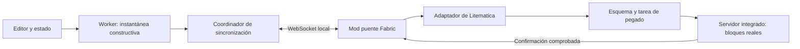

# Spec: preview en vivo mediante Litematica

Fecha: 2026-10-16 (actualizado 2026-10-17 con la revisión del código de Litematica)  
Estado: propuesta para revisión; implementación no iniciada.  
Dependencia arquitectónica: Litematica obligatoria.  
Decisión: mantener Litematica como motor de pegado mediante una tarea propia
(sección 5.2), confirmada por la etapa 1 el 2026-10-17 (sección 5.4).

## 1. Objetivo

Permitir que una persona edite un map art en MapArtisan y vea su construcción
actualizada automáticamente mediante bloques reales en un mundo de pruebas de
Minecraft. Litematica será responsable de representar y pegar el esquema; un
mod puente conectará el navegador con Litematica.

La estructura recibida en Minecraft debe coincidir con la estructura constructiva
que MapArtisan usa para exportar, incluidos alturas, soportes y línea norte
(noobline). Un esquema holográfico por sí solo no cumple el objetivo.

Este documento no autoriza cambios de aplicación ni la creación del mod. Define
el alcance y las comprobaciones previas a implementar.

## 2. Alcance inicial

- Minecraft Java 26.3, Fabric, mundo singleplayer creativo en el mismo equipo.
- Litematica y su MaLiLib compatible instalados como dependencias obligatorias.
- MapArtisan servido localmente; conexión WebSocket mediante loopback.
- Una sesión, una pestaña con control de escritura y una construcción activa.
- Una sección de 128 × 128 a la vez, en modos 2D y 3D valley, según el *File
  Layout* (sección 10.2): un mapa de 1 × 1 con *Single File*, o la sección elegida
  de un mapa de cualquier tamaño con *Multiple Files*.
- Pintura manual, deshacer/rehacer y cambios en imagen, paleta, procesamiento,
  alturas y soportes deben producir una nueva revisión de la construcción.
- Una zona vacía y reservada dentro de un mundo descartable.
- Flujo unidireccional MapArtisan → Minecraft.
- Función oculta por defecto: solo se habilita desde la consola del navegador
  (sección 10.1).

Quedan fuera de v1: multiplayer/LAN, Servux, otros loaders o versiones de
Minecraft, sincronización de ediciones hechas dentro del juego, entidades,
inventarios/NBT de entidades de bloque, varias secciones a la vez, mapas mayores
de 128 en modo de exportación completa, rotaciones arbitrarias, web pública HTTPS
y soporte sin Litematica.

La exportación manual a Litematica/NBT y el preview web deben seguir funcionando
sin conexión al mod. El puente no es necesario para utilizar esas funciones.

## 3. Base existente y punto de integración

Se reutilizará la ruta activa de exportación:

- `src/hooks/useProcessingPipeline.ts`: procesamiento y rechazo de resultados
  obsoletos.
- `src/workers/mapart.worker.ts`: motor, caché y aplicación de ediciones.
- `src/utils/export/blockGeneration.ts`: construcción con coordenadas enteras.
- `src/utils/export/types.ts`: buffers de posiciones e índices de paleta.
- `src/hooks/latestWinsQueue.ts`: patrón de conservar el último trabajo pendiente.

No se usará el módulo legado `src/utils/schematicExport.ts`, que no participa en
la exportación de la interfaz. Tampoco se reconstruirán bloques a partir de las
posiciones visuales centradas del preview Three.js.

Se expondrá una operación del worker que produzca una instantánea constructiva
antes de serializar NBT. Incluirá las ediciones manuales exactamente una vez.
Los buffers transferidos no podrán reutilizarse después de quedar detached.

El disparador debe observar todos los parámetros constructivos, no solo cambios
en la imagen procesada: cambiar el material de soporte también debe sincronizar.

## 4. Arquitectura



### MapArtisan

Genera instantáneas completas y coherentes, asigna revisiones, conserva solo la
última pendiente y presenta el estado de conexión/aplicación. No ejecuta comandos
de Minecraft ni escribe archivos del mundo.

### Mod puente

Será un proyecto Fabric separado de BlockMaps. Gestionará conexión, sesión,
validación, permisos del mundo, área reservada y seguimiento de tareas. El hilo
de red únicamente recibe/valida mensajes; las operaciones del juego se despachan
al hilo apropiado de cliente o servidor.

### Adaptador de Litematica

Crea un esquema y una colocación exclusivos de MapArtisan por revisión, conserva
su origen y ejecuta el pegado con una tarea propia sobre la infraestructura de
Litematica (sección 5.2). Mantendrá las llamadas a sus clases concretas fuera del
protocolo y del resto del puente.

Litematica es obligatoria: si falta o su versión no es compatible, la función
se deshabilita con un diagnóstico. No habrá un motor alternativo de colocación.
El adaptador tampoco modificará otras colocaciones del usuario.

## 5. Comprobación técnica previa obligatoria

Antes de construir la integración completa debe verificarse, con una combinación
fijada de Minecraft/Litematica/MaLiLib:

1. Crear y actualizar un esquema en memoria y registrar su colocación.
2. Mostrar el esquema actualizado sin reiniciar el juego.
3. Iniciar un pegado real en singleplayer creativo.
4. Detectar terminación y fallo de la tarea, no solo que fue programada.
5. Reemplazar bloques y colocar aire para retirar bloques anteriores.
6. Determinar el comportamiento efectivo de `changedBlocksOnly`.
7. Garantizar un único pegado activo y detectar descarga/cambio de mundo.
8. Aplicar el comportamiento necesario sin dejar alteradas preferencias globales
   de Litematica, selección, filtros de capas o tareas ajenas.

La versión exacta soportada de Litematica y MaLiLib se fijará al completar esta
comprobación. No se declarará compatibilidad con todas las versiones. Si no es
posible observar la finalización o controlar el pegado requerido, se revisará el
spec antes de desarrollar el resto; no se emitirá un éxito anticipado.

### 5.1 Revisión del código fuente (2026-10-17)

Se leyó el código de Litematica y MaLiLib para valorar cada punto antes de la
prueba en el juego. Versiones revisadas:

- Rama `26.3` de `sakura-ryoko/litematica`: `0.29.2-sakura.1`, sin publicar,
  con MaLiLib `0.30.2`. Commit `64e7459` del 2026-10-12.
- Tag `26.3-0.29.0`, comparado con la rama en las clases clave.
- Versión fijada: `0.29.1` (publicada el 2026-09-27 en el Maven de sakura-ryoko y
  en Modrinth, sin tag en Git) con MaLiLib `0.30.2`. Está entre las dos versiones
  revisadas. MaLiLib `0.30.2` declara `breaks` con Litematica anterior a `0.29.1`.
- Licencia LGPLv3: un mod independiente puede enlazar y heredar de sus clases.

No existe una API pública para crear y pegar esquemas. La interfaz
`ISchematicPlacementEventListener` solo informa cambios de colocación, no pegados.
Las clases internas cambian incluso entre parches: entre `0.29.0` y la rama,
`SchematicPlacementManager.canHandleChunk` pasó de `protected` a `public` y
`SchematicPlacingUtils` incorporó la opción `pasteAlwaysUsePersistent`.

Estado de cada punto según el código:

| # | Requisito | Hallazgo |
|---|---|---|
| 1 | Esquema en memoria | `LitematicaSchematic.createEmptySchematic(AreaSelection, author)` y `getSubRegionContainer(nombre).set(x, y, z, state)`. |
| 2 | Actualizar sin reiniciar | Se sustituye la colocación: `removeSchematicPlacement(anterior)` y `addSchematicPlacement(nueva, false)`, con `setShouldBeSaved(false)`. El holograma se reconstruye de forma asíncrona en hilos daemon. Modificar el contenedor de un esquema ya registrado no es seguro: lo leen esos hilos y el hilo del servidor. |
| 3 | Pegado real en singleplayer | `pastePlacementToWorld` programa `TaskPasteSchematicPerChunkDirect` en `TaskScheduler.getInstanceServer()`, que corre en el tick del servidor integrado. |
| 4 | Terminación y fallo | `pastePlacementToWorld` devuelve `void` y no expone la tarea. Si la tarea se crea directamente, `TaskBase.setCompletionListener` notifica `onTaskCompleted` o `onTaskAborted` en el hilo del cliente. Un fallo por chunk **no** se notifica: si `placeToWorldWithinChunk` devuelve `false`, el chunk queda pendiente y se reintenta en cada tick indefinidamente. |
| 5 | Reemplazo y aire | Solo con `ReplaceBehavior.ALL`. El valor por defecto de `pasteReplaceBehavior` es `NONE`, que omite toda posición ya ocupada. Con `ALL`, el aire del contenedor se escribe; `structure_void` se omite. El pegado recorre el volumen completo del esquema. |
| 6 | `changedBlocksOnly` | Se ignora en la ruta directa de singleplayer; solo lo usa el pegado por comandos. Escribir el mismo estado que ya existe no produce cambios en el chunk. |
| 7 | Pegado único y cambio de mundo | El puente puede conservar la referencia a su tarea y consultar `TaskScheduler.getAllTasks()`. Defecto detectado: al cambiar de mundo, `DataManager.clear()` limpia solo el scheduler del cliente, y `runTasks()` no ejecuta nada mientras `player == null`. Una tarea del servidor interrumpida no avisa y podría reanudarse en el mundo siguiente con referencias antiguas. Confirmado en el juego (2026-10-17): además, `removeTask` solo busca en `tasks`, no en `tasksToAdd`, así que una tarea programada justo antes de pausar o salir no se retira. Y `Minecraft.disconnect()` llama a `dropAllTasks()`, por lo que el aviso de aborto que Litematica entrega con `Minecraft.execute` se pierde. La tarea propia usa un flag de cancelación respetado por `shouldRemove()` y el puente informa el aborto por salida del mundo sin esperar a Litematica. |
| 8 | Sin alterar configuración global | `pastePlacementToWorld` usa el rango de capas global, y el constructor de la tarea lee `pasteReplaceBehavior` y `pasteLayerBehavior`. Una tarea propia puede pasar `ReplaceBehavior.ALL` y `PasteLayerBehavior.ALL` sin modificar la configuración. Efectos secundarios: `addSchematicPlacement` selecciona la colocación si no había otra seleccionada, y la tarea estándar muestra mensajes en el action bar al terminar. |

Comportamiento útil confirmado: la ruta directa llama a
`placeToWorldWithinChunk(..., notifyNeighbors = false)`. Esto activa la supresión
de actualizaciones de Litematica, cuyos mixins cancelan drops de ítems y omiten
`onPlace`/`onRemove`, y coloca con los flags `0x12`. Los bloques con gravedad no
caen y los bloques apoyados no se rompen durante el pegado.

Condiciones del entorno de las que depende el pegado, sin producir error:
`TaskPasteSchematicPerChunkBase.canProcessChunk` espera hasta que el chunk exista
en el mundo del esquema, no haya reconstrucciones pendientes para él y los chunks
cliente de alrededor (radio 1) estén cargados. El mundo del esquema solo se
llena con chunks cliente cargados, salvo que `loadEntireSchematics` esté activo.
Para un área de unos 9 × 9 chunks, el jugador debe estar cerca. La lectura del
código sugería que también hacía falta `Configs.Visuals.ENABLE_RENDERING`, pero
en el juego el pegado terminó con el renderizado desactivado: las reconstrucciones
que lanza `addSchematicPlacement` solo comprueban `canHandleChunk`.

### 5.2 Integración propuesta

- No llamar a `pastePlacementToWorld`. El adaptador define una tarea que hereda
  de `TaskPasteSchematicPerChunkBase`:
  - registra sus colocaciones por chunk en `onChunkAddedForHandling`;
  - en `processChunk` llama a `SchematicPlacingUtils.placeToWorldWithinChunk`
    con `ReplaceBehavior.ALL`, `PasteLayerBehavior.ALL` y `notifyNeighbors = false`;
  - reproduce en `execute` el presupuesto de 60 ms por tick de
    `TaskPasteSchematicPerChunkDirect`;
  - en `onStop` retira su HUD y notifica sin mensajes en pantalla;
  - expone `pendingChunks.size()` para informar `progress` y alimentar un watchdog.
- Se programa con `TaskScheduler.getInstanceServer().scheduleTask(tarea, 1)` y se
  usa `LayerRange` propio con modo `ALL`.
- Cada revisión crea un esquema y una colocación nuevos. Solo se sustituyen
  cuando no hay pegado activo. El esquema cubre la unión de los límites anterior
  y nuevo, con aire explícito donde la nueva estructura no tiene bloques.
- Al detenerse el servidor integrado (`ServerLifecycleEvents.SERVER_STOPPING`, en
  el hilo del servidor), el puente cancela la tarea: flag respetado por
  `shouldRemove()`, además de `removeTask`. La salida del mundo se detecta en el
  tick del cliente (`level == null`) y ahí el puente informa el aborto él mismo,
  porque el aviso de Litematica no llega tras `Minecraft.disconnect()` (sección
  5.1, punto 7). No se usa `ClientPlayConnectionEvents.DISCONNECT`: en el juego se
  ejecuta en un hilo `Netty Local IO`, no en el del cliente.
- Mientras la tarea no avanza, guarda la causa probable según las condiciones de
  `canProcessChunk` (chunk del holograma sin cargar, reconstrucción pendiente,
  chunks cliente sin cargar o reintentos). El estado es "esperando" con
  diagnóstico, no un error ni un éxito.
- Si no hay avance de `pendingChunks` durante el tiempo de la sección 10, se
  informa el chunk bloqueado y su causa probable; no se programa otro pegado.
- Se fija la versión publicada `0.29.1` con MaLiLib `0.30.2`, no la rama. El adaptador toca unas
  doce clases internas (`LitematicaSchematic`, `AreaSelection`/`Box`,
  `LitematicaBlockStateContainer`, `SchematicPlacement`,
  `SchematicPlacementManager`, `DataManager`, `TaskScheduler`,
  `TaskPasteSchematicPerChunkBase`, `SchematicPlacingUtils`, `ReplaceBehavior`,
  `PasteLayerBehavior` y, de MaLiLib, `LayerRange` e `ICompletionListener`).
  Al iniciar, el puente valida la versión exacta y se deshabilita si no coincide.

### 5.3 Pendiente de verificar en el juego

La lectura del código no resuelve estos puntos; la etapa 1 debe medirlos:

1. Tiempo de reconstrucción del holograma tras sustituir la colocación, y que el
   pegado espere correctamente a que termine.
2. Si `placeToWorldWithinChunk` puede devolver `false` en uso normal, lo que
   provocaría reintentos indefinidos.
3. Salida del mundo a mitad de pegado: limpieza con `removeTask`, notificación de
   aborto y ausencia de escrituras en el mundo siguiente.
4. Tiempo real de pegado de un volumen máximo (unos 4,2 millones de posiciones
   con aire) dentro del presupuesto por tick.
5. Que los bloques colocados con supresión de actualizaciones se mantengan
   estables tras actualizaciones posteriores de vecinos.
6. Que la colocación de MapArtisan no altere la selección ni otras colocaciones
   del usuario, o que se restauren.

### 5.4 Resultados de la etapa 1 (2026-10-17)

Prueba en `MapartisanConnector` con Litematica `0.29.1`, mundo plano creativo y
estructuras sintéticas de 128 × 129 con la disposición de exportación de MapArtisan.
La suite automática `/mapartisan test suite` pasó 15 de 15 pasos en 71 s,
verificando cada pegado bloque a bloque contra el área del mundo.

| Punto | Resultado |
|---|---|
| 1 | La espera al holograma tras sustituir la colocación fue de 60–150 ms. El pegado no empezó antes. |
| 2 | Cero reintentos en todos los pegados. |
| 3 | Aborto antes del primer tick y a mitad del pegado (39/72 chunks pendientes): notificados, y la resincronización posterior dejó el área idéntica. Salida del mundo a mitad de un pegado de max (confirmada a mano tras corregir el primer intento, sección 5.1 punto 7): se informa el aborto con 'mundo cerrado durante el pegado', y al volver a entrar no hay actividad residual. |
| 4 | Volumen máximo (4,2 M posiciones, 72 chunks): 410–530 ms en total. Verificar el área entera en el servidor tarda unos 100 ms. |
| 5 | Colocar y retirar bloques encima de arena, alfombras y hojas con actualizaciones de vecinos no alteró nada. Las hojas con `persistent=true` siguen intactas tras 30 s. Quitar el soporte de la arena la hace caer, como corresponde. |
| 6 | Sin selección previa sigue sin selección. Una colocación ajena seleccionada sigue presente y seleccionada. |

| Watchdog | Con el área a 4096 bloques del jugador, el pegado esperó con 72/72 chunks pendientes, sin escribir ni informar éxito. A los 30 s avisó: "el holograma aún no cargó el chunk [244, -4] (¿jugador lejos?)". El aborto posterior se notificó. |
| Pausa | Con el juego pausado justo después de programar max, el pegado esperó y terminó al reanudar (espera de 4,6 s, pegado de 446 ms). El tiempo de pausa se contabiliza como espera. |

Con esto la etapa 1 queda cerrada: Litematica `0.29.1` cumple los ocho puntos de
la sección 5 mediante la tarea propia de la sección 5.2. Se confirma la decisión
de mantener Litematica como motor de pegado.

## 6. Modelo de estructura y coordenadas

Una instantánea contiene:

- Dimensiones de imagen y límites constructivos derivados de los bloques.
- Paleta de estados canónicos: ID namespaced y propiedades ordenadas.
- Posiciones locales enteras `x`, `y`, `z`, e índice de paleta por posición.
- Configuración constructiva y versión de Minecraft objetivo.
- Identificador y revisión de la sesión.

No se transmiten texturas ni colores RGB para colocar bloques. El mod resuelve
IDs y propiedades mediante el registro de Minecraft. Un ID o propiedad inválidos
rechazan toda la revisión antes de aplicar cambios; no se sustituyen por aire.
Posiciones duplicadas o fuera de límites también se rechazan.

Para v1, el origen elegido en Minecraft corresponde a `(0,0,0)` de la estructura
exportada: la línea norte ocupa `z=0` y la primera fila de píxeles `z=1`.
Se conserva la orientación de exportación, con el norte hacia Z negativa.
La alineación con mapas de escala 0 debe verificarse incluyendo esa fila extra;
la posición del jugador no se usa como origen móvil.

El origen y la dimensión quedan bloqueados durante la sesión. Cambiarlos requiere
detenerla y configurar otra área. Se validarán alturas reales del mundo.

## 7. Sustitución y limpieza

V1 transmitirá instantáneas completas. La optimización interna de pegado podrá
usar cambios únicamente si las pruebas demuestran que conserva el resultado.

El adaptador conservará los límites anteriores y nuevos. Dentro de la unión de
ambos volúmenes, las posiciones ausentes en la nueva estructura deben convertirse
en aire. Esto incluye bloques desplazados, soportes retirados y reducción de
altura. No basta pegar únicamente bloques no vacíos.

El área reservada debe estar vacía al iniciar y pertenecer exclusivamente a esta
sesión. El pegado, incluido el aire, queda limitado a ella. No se promete conservar
construcciones introducidas manualmente dentro de esa zona durante la sesión.

Un cambio de píxel 3D puede desplazar toda una columna. Se regenera la instantánea
constructiva para reflejar Smart Drop, normalización vertical y soportes. No se
asume que una pincelada corresponde a una única posición del mundo.

La supresión de actualizaciones de Litematica (sección 5.1) evita caídas y drops
durante el pegado, pero no los ticks aleatorios posteriores. Las hojas se exportan
hoy sin propiedades, es decir, con `persistent=false`, y se descomponen; el hielo
puede derretirse. La opción `pasteAlwaysUsePersistent` solo existe en la rama sin
publicar y está desactivada por defecto. La instantánea, y también la exportación,
deben emitir las hojas con `persistent=true`. Las reglas del mundo de pruebas
para el resto de bloques afectados se definirán en la etapa 1.

## 8. Protocolo local v1

WebSocket con protocolo versionado. El servidor escucha exclusivamente en
loopback, en un puerto configurable; nunca en todas las interfaces por defecto.

Mensajes lógicos:

| Mensaje | Dirección | Finalidad |
|---|---|---|
| `hello` / `welcome` | Ambas | Autenticar token, negociar protocolo y capacidades/versiones. |
| `openSession` / `sessionReady` | Ambas | Seleccionar mundo, dimensión, origen y área; conceder escritura. |
| `snapshotBegin` | Web → mod | Declarar revisión, base aplicada, límites, paleta y tamaños. |
| `snapshotChunk` | Web → mod | Transportar bloques por partes numeradas. |
| `snapshotEnd` | Web → mod | Cerrar transferencia e iniciar validación completa. |
| `accepted` | Mod → web | Transferencia validada; aún no significa aplicada. |
| `progress` | Mod → web | Informar la fase y avance comprobable. |
| `applied` | Mod → web | Confirmar que terminó la colocación de esa revisión. |
| `rejected` / `failed` | Mod → web | Informar código, revisión y posible aplicación parcial. |
| `status` / `ping` / `pong` | Ambas | Recuperar estado y detectar desconexiones. |
| `closeSession` | Web → mod | Detener la sesión y liberar el control de escritura. |

El sobre incluye `protocolVersion`, `sessionId` y `type`; los mensajes de
estructura añaden `revision`. `snapshotBegin` incluye `baseRevision`, que debe
coincidir con la última revisión aplicada reconocida por el mod.

Formato inicial: JSON, paleta compartida y listas compactas de enteros para
posiciones/índices. Cada transferencia declara número de partes y bloques;
partes faltantes, duplicadas o tamaños inconsistentes impiden aplicarla. No se
comienza a pegar mientras faltan partes. Se medirán costos antes de decidir
si una versión posterior necesita un formato binario.

Un resultado repetido de una revisión ya aplicada devuelve su confirmación sin
programar otro pegado. El mismo número con otro contenido se rechaza. La sesión
no se restaura silenciosamente tras reiniciar el mod.

## 9. Concurrencia y recuperación

- Una revisión en transferencia/aplicación y una instantánea pendiente reemplazable.
- Agrupación inicial de cambios de aproximadamente 200 ms; no es una garantía de latencia.
- Una edición nueva reemplaza la pendiente; no cancela a mitad el pegado activo.
- La base de la siguiente revisión se establece después de recibir `applied`.
- Resultados del worker que ya no corresponden al editor se descartan antes de enviar.
- Un timeout o corte de conexión nunca se interpreta como éxito ni provoca repetir
  automáticamente una tarea cuyo estado se desconoce.
- Tras reconectar se consulta la sesión. Si sigue activa y no tiene trabajo en
  curso, se solicita una instantánea completa con la base confirmada.
- Si hubo pegado parcial, se entra en `needsResync`. Se conserva la unión del área
  que pudo tocarse y se exige una resincronización completa controlada.
- Cambiar o cerrar el mundo invalida el destino y la sesión. El puente retira
  explícitamente su tarea del scheduler del servidor (sección 5.2) y lo informa
  como `failed` con posible aplicación parcial.
- No hay rollback instantáneo prometido. La recuperación es una resincronización
  completa; cerrar la sesión deja los bloques existentes en el mundo.

Estados visibles: desconectado, conectando, conectado sin destino, sincronizando,
sincronizado, pausado y error/requiere resincronización. La interfaz distinguirá
revisión del editor de revisión aplicada. Minecraft pausado debe figurar como
esperando al juego, sin acumular tareas ni confirmar una aplicación inexistente.

## 10. Controles y límites

### 10.1 Habilitación desde la consola

El conector no aparece en la interfaz por defecto. Se habilita o deshabilita
desde la consola de DevTools del navegador, con una API global mínima:

```js
mapartisan.connector.enable()   // muestra los controles del conector
mapartisan.connector.disable()  // cierra la sesión y oculta los controles
mapartisan.connector.status()   // informa si está habilitado y el estado de la conexión
```

La consola de DevTools evalúa JavaScript, así que no admite una sintaxis tipo
`/connector enable`; las funciones cumplen el mismo papel.

- El estado se guarda en `localStorage` con la clave `mapartisan:connector`, igual
  que el flag de diagnósticos `mapartisan:debug`, y sobrevive a recargas. Si
  `localStorage` no está disponible, la función queda deshabilitada.
- Deshabilitado, MapArtisan no muestra controles, no abre WebSocket y no carga el
  módulo del conector: el objeto global solo contiene estas tres funciones, y el
  resto se importa de forma diferida al habilitar.
- `enable()` y `disable()` surten efecto sin recargar la página. `disable()` con
  una sesión activa envía `closeSession` y desconecta; los bloques ya colocados
  quedan en el mundo (sección 9).
- Es un control de visibilidad, no de seguridad: cualquiera puede llamarlo desde
  la consola. La protección del puente sigue siendo el token, el encabezado
  Origin y el loopback de esta sección.

### 10.2 Disponibilidad según el *File Layout*

El conector solo sincroniza con estas combinaciones del control *File Layout*
(`exportMode`) de *Construction Model*:

| *File Layout* | Tamaños admitidos | Qué se renderiza |
|---|---|---|
| *Single File* (`full`) | Solo 1 × 1 | El mapa completo. |
| *Multiple Files* (`sections`) | Cualquiera, incluido 1 × 1 | La sección elegida en *3D Preview Area* (`previewSection`), una a la vez. En 1 × 1 es la única sección, `(0, 0)`. |

- Con la única combinación no admitida, un mapa mayor de 1 × 1 con *Single File*,
  los controles del conector siguen visibles si está habilitado,
  pero no se generan ni envían instantáneas. Se indica el motivo y el cambio
  necesario, por ejemplo "Usa *Multiple Files* para mapas de más de 1 × 1".
- Si la combinación deja de ser válida durante una sesión, la sincronización se
  pausa con ese motivo y se reanuda al volver a una combinación válida. Los
  bloques ya colocados quedan en el mundo.
- Elegir otra sección en *3D Preview Area* produce una nueva revisión en la misma
  área reservada (sección 12.1). El selector ya existe y se usa para la vista 3D,
  así que no se añade otro control.
- El modo global o independiente de los mapas no cambia la disponibilidad: ambos
  se admiten con *Multiple Files*.

### 10.3 Controles

MapArtisan ofrece conectar, desconectar, activar sincronización automática,
pausar envíos y resincronizar. Muestra mundo/dimensión, origen y revisión aplicada.
Pausar detiene nuevos envíos; una tarea activa termina si el juego sigue avanzando.
Desconectar no borra la construcción. La limpieza explícita de toda el área queda
fuera del primer prototipo.

El token se genera en el mod y se introduce en MapArtisan; no se guarda en el
repositorio ni se imprime completo en los logs. El puente valida el encabezado
Origin contra los orígenes locales configurados y limita una pestaña escritora.
El protocolo acepta estructuras, nunca comandos arbitrarios ni rutas de archivos.

Límites iniciales propuestos, sujetos a medición:

- Imagen: 128 × 128; altura constructiva máxima: 256 bloques, si cabe en el mundo.
- Hasta 65.536 posiciones explícitas y 8 millones de posiciones en el volumen de pegado.
- Mensajes de hasta 256 KiB; transferencia acumulada de hasta 16 MiB.
- Recepción incompleta: timeout de 10 segundos sin progreso.
- Aplicación: aviso tras 30 segundos sin progreso, consulta de estado y diagnóstico;
  no se programa otro pegado por ese motivo.

Superar límites se comunica antes de pegar. Se validan números enteros finitos,
límites de arrays y paleta, IDs y dimensiones para evitar asignaciones descontroladas.
No se mantiene cargado un número ilimitado de chunks. La estrategia de carga y
liberación de tickets se verificará junto con el comportamiento de Litematica.

## 11. Criterios de aceptación

1. Un diseño 128 × 128 se coloca con IDs, propiedades, alturas, soportes y noobline
   equivalentes a los buffers constructivos de exportación.
2. Cambiar material, altura o soporte reemplaza lo necesario y retira lo obsoleto.
3. Deshacer/rehacer converge al mismo resultado que una exportación del editor.
4. Una ráfaga de cambios termina en la última revisión, sin pegar versiones antiguas después.
5. `applied` solo llega al terminar; el estado de éxito se comprueba contra el área
   del mundo en las pruebas de integración, no solo contra llamadas del adaptador.
6. Desconexión, pausa del juego, fallo parcial y cambio de mundo no producen falsos éxitos.
7. No se toca ningún bloque fuera del área ni se alteran colocaciones/configuraciones ajenas.
8. Estados desconocidos y mensajes inválidos se rechazan antes de modificar el mundo.
9. El preview web y las exportaciones existentes funcionan con la función desconectada.
10. Sin habilitar desde la consola no hay controles visibles, conexiones WebSocket
    ni carga del módulo del conector.
11. Con un *File Layout* no admitido para el tamaño del mapa (sección 10.2) no se
    envía ninguna instantánea y se muestra el motivo.

Pruebas: contratos y revisiones del protocolo; ensamblado de transferencias;
comparación de instantáneas con fixtures existentes de exportación; secuencias de
edición; integración real Fabric/Litematica para sustitución, aire y finalización;
comparación del registro de bloques del área con la instantánea esperada.

Se medirán tiempos de generación, transferencia, espera y pegado por separado.
El presupuesto de latencia se fijará tras el prototipo; no se promete un pegado
completo por frame ni cambios instantáneos bajo cualquier carga.

## 12. Etapas de implementación propuestas

1. Prueba técnica en el juego de la tarea propia de la sección 5.2 contra
   Litematica `0.29.1`, cubriendo los puntos de la sección 5.3. El proyecto Fabric
   es `MapartisanConnector`, junto a MapArtisan y BlockMaps.
2. Contrato de instantánea del worker y equivalencia con la exportación.
3. Puente local y pegado completo manual de una revisión.
4. Reemplazo con aire, confirmaciones, recuperación y aislamiento del destino.
5. Sincronización automática, controles y pruebas de ráfagas/undo/redo.
6. Medición y ajustes; solo después evaluar varias secciones a la vez, Servux o
   web publicada.

Prerrequisito de producto: Minecraft 26.3 ya está habilitado en las versiones
soportadas de MapArtisan (versión por defecto, DataVersion 5023), y los formatos
exportados se validaron en el juego el 2026-10-17.

### 12.1 Diseño de la etapa 2: instantánea constructiva

Decidido el 2026-10-17. Objetivo: que el worker produzca la instantánea que
recibirá el mod, idéntica bloque a bloque al archivo que MapArtisan exportaría
para esa misma sección.

**Función compartida.** La generación de bloques de una sección se extrae a una
única función que usan `generateMapartExportV1` (para el archivo único y para
cada archivo del ZIP por secciones) y la nueva operación del worker. La
equivalencia queda garantizada por construcción; las pruebas la confirman.

**Secciones.**

Las combinaciones admitidas son las de la sección 10.2.

- Mapa de 1 × 1 con *Single File* (`exportMode: 'full'`): hay una sola sección,
  `(0, 0)`, igual al archivo único exportado.
- Cualquier tamaño, incluido 1 × 1, con *Multiple Files* (`exportMode:
  'sections'`), global o independiente: la sección es la elegida en *3D Preview
  Area* (`previewSection`).
  La instantánea es exactamente lo que `splitBlocksIntoSections` asigna a esa
  sección: coordenadas locales, noobline en `z=0`, fila compartida en el borde en
  modo global y re-normalización vertical en modo independiente.
- Un mapa mayor de 1 × 1 con *Single File*, o una sección fuera de rango: la
  operación lo rechaza con un error explícito.
- Se renderiza una sección a la vez. Cambiar de sección es una revisión más en la
  misma área reservada: el mod limpia con la unión de límites (sección 7), sin
  abrir otra sesión.
- En modo global las alturas de una sección no se re-normalizan, así que su
  volumen puede empezar por encima de `y=0`. Es el mismo comportamiento que el
  archivo exportado.

**Formato de la instantánea.**

| Campo | Contenido |
|---|---|
| `section` | `sX`, `sY` y la cuadrícula `mapsX × mapsY`. |
| `bounds` | Tamaño local derivado de los bloques. |
| `palette` | Estados canónicos `minecraft:id[clave=valor,...]` con las propiedades ordenadas alfabéticamente. |
| `x`, `y`, `z`, `paletteIndices` | `Int32Array` / `Uint32Array` recortados con `.slice()` a la longitud exacta y transferidos. |
| `config` | Modo de construcción, soporte, material de soporte y versión de Minecraft objetivo. |
| `contentHash` | Hash no criptográfico de 64 bits (p. ej. FNV-1a) de la paleta y los arrays en el orden emitido, que es determinista para la misma entrada. No depende de `crypto.subtle`, que no existe fuera de contextos seguros. |

La revisión y la sesión no forman parte de la instantánea: las asigna el
coordinador de la etapa 5.

Detalles de la implementación (paso 3, `src/utils/export/snapshot.ts` y
`generateConstructionSnapshotV1` del worker):

- La paleta se reduce a los estados canónicos que usa la sección, en orden de
  primer uso. Así, editar otra sección o cambiar la configuración sin cambiar
  bloques no altera el hash de esta.
- El hash cubre solo el contenido (paleta y bloques), no la sección ni la
  configuración: dos instantáneas con el mismo contenido producen el mismo mundo.
- Si una posición se escribe dos veces, se conserva el último bloque, igual que
  los escritores de NBT.
- La combinación de *File Layout* y sección se valida antes de procesar la imagen.
  Un rechazo vuelve como respuesta tipada (`status: 'rejected'` con `code`), no
  como excepción: Comlink solo transporta el mensaje, el nombre y la pila de un
  error, y el código se perdería.

**Estados canónicos y hojas.** Una sola función produce el estado canónico de
cada bloque y la usa la generación compartida. Así la instantánea, la exportación
`.litematic` y la `.nbt` reciben lo mismo:

- propiedades ordenadas alfabéticamente;
- las hojas llevan `persistent=true`. Hoy se exportan sin propiedades, con
  `persistent=false`, y se descomponen tras pegarlas. Esto corrige también la
  exportación actual.

**Pruebas.**

1. Equivalencia: para fixtures de un mapa y multisección (global e
   independiente), 2D y 3D, con ediciones manuales y con cada modo de soporte,
   decodificar el NBT exportado de cada sección y compararlo bloque a bloque con
   la instantánea de esa sección.
2. Hash estable para la misma entrada y distinto ante un cambio de bloque, altura
   o soporte.
3. Hojas con `persistent=true` en `.litematic`, `.nbt` e instantánea.
4. Buffers transferidos con la longitud exacta.
5. Rechazo de las combinaciones no admitidas de la sección 10.2 y de secciones
   fuera de rango.
6. Golden fixtures: idénticos tras extraer la función compartida. Solo pueden
   cambiar por el arreglo de hojas, revisando el diff.

**Orden de trabajo.** Cada paso es un cambio independiente con las pruebas en
verde:

1. Hojas con `persistent=true` en la exportación, actualizando los goldens si
   corresponde.
2. Extraer la función compartida sin cambiar la salida: goldens idénticos.
3. Operación de instantánea del worker con hash y selección de sección.
4. Pruebas de equivalencia de la lista anterior.

Fuera de la etapa 2: protocolo, coordinador, interfaz y habilitación desde la
consola (sección 10.1).

Punto de partida verificado el 2026-10-17: 987 pruebas y 617 golden fixtures en
verde.

**Resultado (2026-10-17).** Etapa 2 completada en cuatro cambios:

1. Hojas con `persistent=true` en `.litematic` y `.nbt`. Los goldens no cambiaron:
   son de procesamiento, no de exportación.
2. `generateConstructionSections`, la función compartida. La salida exportada no
   cambió: el SHA-256 de 8 exportaciones de prueba coincide antes y después.
3. `generateConstructionSnapshotV1` en el worker, con `snapshot.ts`.
4. `snapshotEquivalence.test.ts`: con la misma petición del worker, cada archivo
   exportado, decodificado con un lector de NBT independiente
   (`nbtTestReader.ts`), coincide bloque a bloque y en tamaño con la instantánea
   de su sección. Cubre 7 casos: 1 × 1 con *Single File* y *Multiple Files*,
   2 × 2 global e independiente y 2 × 1 independiente; 2D y 3D; los tres modos
   de soporte; límite de altura; ediciones manuales; `.litematic` y `.nbt`.
   Se comprobó con dos mutaciones (sin canonicalizar y un bloque desplazado) que
   la prueba falla ante diferencias.

Total: 1015 pruebas y 617 golden fixtures en verde.

## 13. Referencias consultadas

- Código del gestor de colocaciones de Litematica, rama 26.3:
  https://raw.githubusercontent.com/sakura-ryoko/litematica/26.3/src/main/java/fi/dy/masa/litematica/schematic/placement/SchematicPlacementManager.java
- Clases revisadas el 2026-10-17 en la rama 26.3 (commit `64e7459`) y el tag
  `26.3-0.29.0`: `scheduler/TaskScheduler`, `scheduler/tasks/TaskBase`,
  `TaskProcessChunkBase`, `TaskPasteSchematicPerChunkBase`,
  `TaskPasteSchematicPerChunkDirect`, `util/SchematicPlacingUtils`,
  `schematic/LitematicaSchematic`, `schematic/placement/SchematicPlacement`,
  `config/Configs`, `data/DataManager`, `mixin/block/MixinBlock`,
  `mixin/world/MixinLevelChunk`:
  https://github.com/sakura-ryoko/litematica/tree/26.3/src/main/java/fi/dy/masa/litematica
- Publicaciones de Litematica:
  https://github.com/sakura-ryoko/litematica/releases
- Documentación de pegado, con diferencias entre singleplayer y servidores:
  https://github.com/maruohon/litematica/wiki/Schematic-Pasting
- Servux 26.3, como posible ampliación posterior:
  https://github.com/sakura-ryoko/servux/blob/26.3/FEATURES.md
- Arquitectura cliente/servidor de Fabric:
  https://docs.fabricmc.net/develop/networking
- Conexiones WebSocket y restricciones del navegador:
  https://developer.mozilla.org/en-US/docs/Web/API/WebSockets_API/Writing_WebSocket_client_applications
